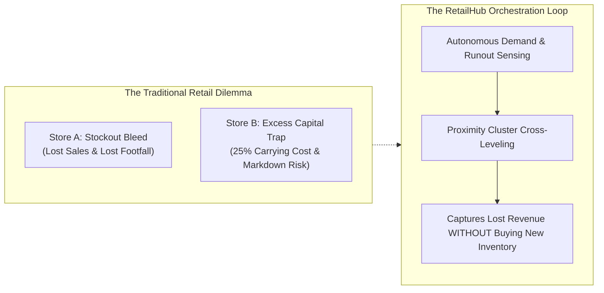
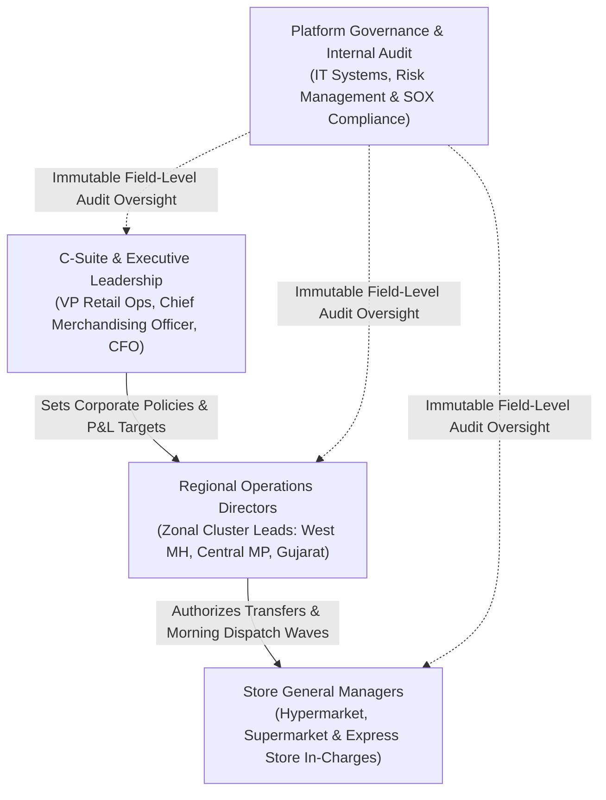
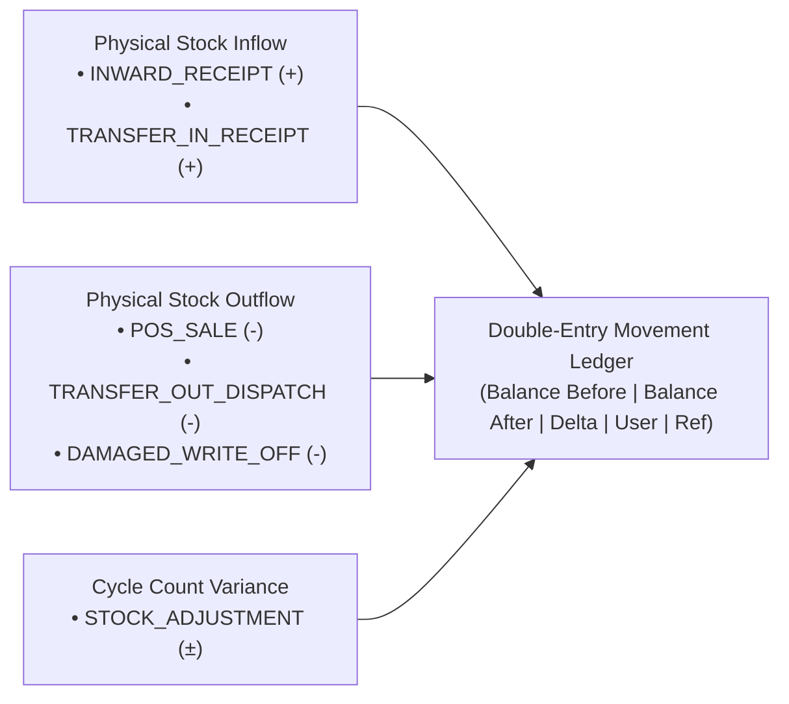
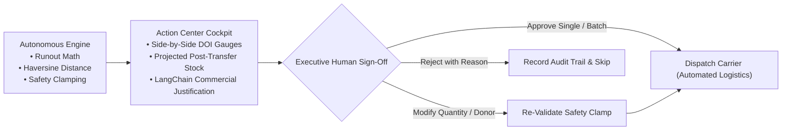

# RETAILHUB ENTERPRISE: COMMERCIAL & STRATEGIC REFERENCE GUIDE
## Autonomous Working Capital Optimization, Inventory Velocity & Regional Profit Rebalancing
**Confidential & Proprietary — Prepared for Client Executive Leadership & Board Walkthrough**

---

  <h3>RETAILHUB ENTERPRISE STRATEGY & COMMERCIAL PROPOSITION</h3>
  
<b>An Autonomous Profit & Multi-Echelon Inventory Orchestration Platform</b>

  
<i>Engineered for High-Velocity, Value-Driven Retail Networks (D-Mart / JioMart Model)</i>

---

## EXECUTIVE TABLE OF CONTENTS
- [PAGE 1: Executive Summary & The Retail Working Capital Challenge](#page-1-executive-summary--the-retail-working-capital-challenge)
- [PAGE 2: Corporate Governance, Roles & Delegation of Authority Matrix](#page-2-corporate-governance-roles--delegation-of-authority-matrix)
- [PAGE 3: Merchandising Strategy, Pricing Integrity & Asset Protection](#page-3-merchandising-strategy-pricing-integrity--asset-protection)
- [PAGE 4: Autonomous Profit Protection & Intelligent Capital Allocation](#page-4-autonomous-profit-protection--intelligent-capital-allocation)
- [PAGE 5: Commercial Decision Cockpit & Human-in-the-Loop Risk Controls](#page-5-commercial-decision-cockpit--human-in-the-loop-risk-controls)
- [PAGE 6: Executive Analytics, Financial Auditability & C-Suite Demo Pitch Script](#page-6-executive-analytics-financial-auditability--c-suite-demo-pitch-script)

---

<!-- PAGE BREAK -->

# PAGE 1: Executive Summary & The Retail Working Capital Challenge

### 1.1 The Macro Retail Challenge: The Working Capital Dilemma
Modern discount hypermarket and supermarket operations operate in a high-stakes commercial environment characterized by:
* **Razor-Thin Operating Margins**: EBITDA margins typically hover between **3.5% and 6.0%**. In this environment, profit expansion is driven not by price gouging, but by **inventory velocity and working capital turns**.
* **The Stockout Penalty (Lost Top-Line)**: When a store runs out of top-selling essentials (e.g., staples, cooking oil, dairy, tea), customer basket size drops immediately. Worse, repeat stockouts permanently erode customer lifetime value (LTV) as consumers migrate to competing modern trade or quick-commerce alternatives.
* **The Excess Capital Trap (Carrying Cost Drag)**: Simultaneously, holding surplus inventory in a neighboring store incurs an annualized **carrying cost of 20% to 25%** (capital finance cost, warehouse holding, spoilage, shrinkage, and forced markdown losses).
* **The Structural Disconnect**: In uncoordinated retail networks, Store A suffers out-of-stock (OOS) conditions while Store B (just 20 km away in the same urban cluster) sits on a 45-day excess supply. Traditional ERPs respond by generating expensive emergency supplier purchase orders (requiring cash outlays, minimum order quantities, and 7-to-14 day lead times) rather than cross-leveling existing inventory.

---

### 1.2 The RetailHub Value Proposition: Unlocking Trapped Capital
RetailHub is an **Autonomous Profit & Inventory Optimization Infrastructure**. It transforms inventory from a static balance-sheet liability into an active, dynamic asset:
1. **Zero New Capital Expenditure**: Fulfills customer demand at depleted stores by tapping into idle, already-purchased stock sitting in sister stores within the same geographical cluster.
2. **Gross Margin Return on Investment (GMROI) Acceleration**: By accelerating turns and eliminating markdowns on slow-moving inventory, RetailHub directly expands return on inventory investment.
3. **Cash Conversion Cycle (CCC) Compression**: Shrinks the days between cash paid to suppliers and cash collected at registers by moving goods directly into high-velocity sales channels.

---

### 1.3 Key Commercial & Financial Impact Benchmarks

| Strategic Business Metric | Commercial Impact with RetailHub | Financial Impact on Enterprise P&L |
| :--- | :--- | :--- |
| **Preventable Stockout Reduction** | **18% to 25% Reduction** in stockout incidents | Direct **+1.8% to +3.2% Top-Line Revenue Expansion** |
| **Carrying Cost Reduction** | **15% to 22% Reduction** in dormant excess inventory | **Free Cash Flow (FCF) unlocked** for operational growth |
| **Gross Margin Protection** | **100% Pricing Governance** ($\text{MRP} \ge \text{Selling Price} \ge \text{Cost}$) | Elimination of inadvertent below-cost loss-leader sales |
| **Replenishment Cycle Time** | **Same-Day / Next-Shift Fulfillment** (< 6 to 12 hours) | 85% faster than 7-to-14 day vendor purchase orders |
| **Network Rebalancing Latency** | **4,558 Store-SKU pairs evaluated in < 1,600 ms** | Real-time demand capture vs. slow overnight batch runs |
| **Logistics Fleet Efficiency** | **Haversine Distance Clustering** | Minimizes truck route kilometers per transfer unit |

---

<!-- PAGE BREAK -->

# PAGE 2: Corporate Governance, Roles & Delegation of Authority Matrix

Enterprise retail governance demands clear **Segregation of Duties (SoD)** and strict **Delegation of Authority (DoA)**. RetailHub translates corporate operational policy into automated, tamper-proof system boundaries through its server-side scoping architecture.

---

### 2.1 Corporate Organizational Alignment

#### 1. Executive Leadership (`EXECUTIVE` — VP Retail Operations, CMO, CFO)
* **Strategic Mandate**: Maximizing national return on capital, safeguarding enterprise gross margins, and driving overall retail network profitability.
* **Operational Scope**: Enterprise-wide national visibility across all stores, regions, and distribution centers.
* **Commercial Authority**: Full board-level visibility into inventory valuation, net sales velocity, stockout risk dollar exposures, and inter-cluster rebalancing trends. Authority to approve national supply allocations and override standard replenishment ceilings.

#### 2. Regional Directors (`REGIONAL_MANAGER` — Zonal Cluster Leads)
* **Strategic Mandate**: Optimizing cluster-wide fill rates, minimizing regional logistics expenses, and coordinating store synergies across 8 to 25 stores in a zone.
* **Operational Scope**: Scoped strictly to all hypermarkets, supermarkets, and fulfillment centers in their designated regional cluster.
* **Commercial Authority**: Sole authority to approve, modify, or reject inter-store transfer proposals. Can execute multi-store batch approvals for morning dispatch waves, ensuring inventory moves smoothly without congesting logistics docks.

#### 3. Store General Managers (`STORE_MANAGER` — Retail Store In-Charges)
* **Strategic Mandate**: Floor-level customer fulfillment, shelf availability on core revenue lines, local shrinkage control, and dock receiving.
* **Operational Scope**: Quarantined strictly to their assigned physical retail store.
* **Commercial Authority**: Authorized to submit floor-level replenishment requests, perform physical dock inward receipts, verify carrier shortfalls, and record audited cycle count adjustments. Commercial data (margins, costs, and valuations) of neighboring stores is masked to maintain organizational privacy and commercial confidentiality.

#### 4. Platform Governance & Compliance (`ADMIN` — Corporate Audit & IT Governance)
* **Strategic Mandate**: Enforcing SOX / regulatory compliance, maintaining tamper-proof audit trails, and managing user access governance.
* **Operational Scope**: Enterprise-wide configuration and governance access.
* **Commercial Authority**: Manages Argon2 identity credentials, binds regional scopes, maintains Slowly Changing Dimensions (SCD Type 2) inventory rule baselines, and inspects immutable JSON field-level diffs.

---

### 2.2 Delegation of Authority (DoA) & Risk Governance Matrix

| Commercial & Operational Function | Store General Manager | Regional Director | Executive (C-Suite) | Internal Audit / Admin |
| :--- | :---: | :---: | :---: | :---: |
| **Enterprise P&L, Valuation & Margin Analytics** | ❌ Masked | ❌ Masked | ✅ Full Access | ✅ Full Access |
| **Cluster Revenue & Velocity Heatmaps** | ❌ Masked | ✅ Cluster Scoped | ✅ Enterprise-Wide | ✅ Full Access |
| **Local Store Stock & Shelf Availability** | ✅ Own Store Only | ✅ Cluster Scoped | ✅ Enterprise-Wide | ✅ Full Access |
| **Onboard New Products & Master Pricing** | ❌ Blocked | ❌ Blocked | ❌ Read-Only | ✅ Full Authority |
| **Physical Stock Adjustments (Cycle Variances)** | ✅ Own Store Only | ✅ Cluster Scoped | ❌ Blocked | ✅ Override Authority |
| **Dock Inward Receiving & Shortage Settlement** | ✅ Own Store Dock | ❌ Read-Only | ❌ Read-Only | ✅ Full Authority |
| **Raise Store Replenishment Request** | ✅ Own Store Only | ✅ Cluster Scoped | ❌ Blocked | ✅ Full Authority |
| **Authorize Inter-Store Stock Transfer** | ❌ Blocked | ✅ Cluster Scoped | ✅ National Authority | ✅ Full Authority |
| **Batch Approve Morning Logistics Waves** | ❌ Blocked | ✅ Cluster Scoped | ✅ National Authority | ✅ Full Authority |
| **Override Transfer Quantity / Donor Store** | ❌ Blocked | ✅ (Safety Clamped) | ✅ (Safety Clamped) | ✅ Full Authority |
| **Reject Transfer (With Mandatory Business Rationale)**| ❌ Blocked | ✅ Cluster Scoped | ✅ National Authority | ✅ Full Authority |
| **Set Background Rebalance Schedule Waves** | ❌ Blocked | ❌ Blocked | ❌ Blocked | ✅ Full Authority |
| **Enforce SCD Type 2 Minimum Buffer Policies** | ❌ Blocked | ❌ Blocked | ❌ Read-Only | ✅ Full Authority |
| **Inspect Immutable Audit Diffs & Governance Logs** | ❌ Blocked | ❌ Blocked | ✅ Read-Only | ✅ Full Inspection |

---

<!-- PAGE BREAK -->

# PAGE 3: Merchandising Strategy, Pricing Integrity & Asset Protection

### 3.1 D-Mart Value-Pricing Governance: Safeguarding Gross Margin
In high-velocity discount retail, margin leakage can occur through human data-entry error or miscalculated promotional pricing. RetailHub enforces strict algorithmic pricing governance at the catalog ingestion point:

$$\text{Maximum Retail Price (MRP)} \ge \text{Store Selling Price} \ge \text{Procurement Cost Price}$$

* **Elimination of Loss-Making Sales**: The system programmatically blocks any product creation, pricing update, or CSV batch upload where the Selling Price falls below Cost Price. This prevents inadvertent negative gross margin sales across all catalog items.
* **Customer Value Proposition Assurance**: Enforces that the consumer always receives a discount equal to or better than the government-mandated MRP, protecting retail brand credibility.
* **Resilient Bulk Ingestion**: Enterprise merchants can onboard seasonal catalogs of up to 1,000 SKUs via CSV, processed in isolated 100-item chunks with instant validation error telemetry.

---

### 3.2 Double-Entry Asset Accounting: Precision Asset Protection
Physical retail inventory is cash sitting on shelves. RetailHub treats physical stock with the same rigor as financial accounting:
* **Milligram-Level 3-Decimal Precision (`Decimal(10, 3)`)**: Bulk agricultural commodities (sugar, pulses, rice, wheat) and loose produce experience fractional weight losses that cannot be captured by integer-based ERPs. RetailHub tracks all stock down to 0.001 units, eliminating cumulative fractional rounding discrepancies.
* **Double-Entry Movement Ledger**: Stock balances cannot be arbitrarily overwritten. Every physical change requires an immutable entry in the `InventoryMovement` ledger:

* **Optimistic Locking (`INV_CONCURRENCY_CONFLICT`)**: High-volume checkouts occurring simultaneously with dock inward receipts can cause phantom inventory. RetailHub uses atomic row versioning (`version = version + 1`). If a balance changes during checkout computation, the transaction rolls back cleanly, protecting inventory ledger integrity.

---

### 3.3 Audited 3-Step Transit Asset Chain & Shortfall Settlement
Inter-store road transit is a primary source of retail shrinkage, cargo loss, and damage disputes between store managers:
1. **Initiation (`PENDING_APPROVAL`)**: Demand is verified against regional donor capacity.
2. **Dispatch (`APPROVED_IN_TRANSIT`)**: Goods are legally transferred out of the donor store's available inventory and moved into an audited `inTransitQuantity` balance. A formal Dispatch Note Number, carrier identity (e.g., BlueDart Express Logistics), and vehicle registration number are locked to the shipment. Neither store can sell this inventory while it is on the road.
3. **Dock Verification & Automated Damage Write-Off (`RECEIVED`)**: The receiving store scans the incoming shipment at the dock:
   * **Exact Match**: If all units arrive intact, stock moves directly into available inventory.
   * **Transit Shortfall / Breakage Settlement**: If 25 units were dispatched but only 22 arrive intact, the system books the 22 units into available stock and **automatically executes an audited `DAMAGED_WRITE_OFF` for the remaining 3 units**. This immediately updates the accounting ledger and attributes the shortfall directly to the carrier's SLA manifest, preventing finger-pointing between store managers.

---

<!-- PAGE BREAK -->

# PAGE 4: Autonomous Profit Protection & Intelligent Capital Allocation

### 4.1 Proactive vs. Reactive Supply Chains: The Strategic Shift
Traditional retail supply chains are **reactive**: a store manager notices empty shelves on Sunday night, places an emergency PO on Monday, the vendor processes it by Wednesday, and goods arrive the following week—resulting in 7 to 10 days of lost revenue.

RetailHub operates **proactively**:
* Real-time register sales dynamically update rolling Average Daily Sales (ADS).
* The engine projects the exact runout horizon (Days of Inventory — DOI) every hour.
* When an item breaches the 3.0-day safety threshold, the system automatically sources inventory from a sister store in the same city or cluster, enabling **same-day or next-shift inter-store fulfillment**.

```mermaid
flowchart TD
    subgraph Reactive["Traditional Reactive Supply Chain (7–14 Days Lead Time)"]
        R1["Empty Shelf Detected"] --> R2["Manual Emergency PO"]
        R2 --> R3["Vendor Approval & Production"]
        R3 --> R4["Long-Haul Freight Transit"]
        R4 --> R5["Shelf Restocked (7–10 Days of Lost Revenue)"]
    end
    subgraph Proactive["RetailHub Autonomous Rebalancing (Same-Day / Next-Shift)"]
        P1["Continuous ADS Runout Math"] --> P2["Autonomous Donor Discovery"]
        P2 --> P3["Same-Day Regional Cross-Leveling"]
        P3 --> P4["Shelf Replenished in < 6–12 Hours (Zero Revenue Loss)"]
    end
```

---

### 4.2 The 7-Day Donor Safety Floor: Protecting Commercial Health
A fundamental flaw in naive rebalancing tools is that transferring stock from Store B to solve a stockout at Store A often causes Store B to run out of stock three days later—doubling logistics costs and irritating both store managers.

RetailHub enforces the **7-Day Donor Safety Floor**:

$$\text{Projected Post-Transfer DOI}_{\text{donor}} = \frac{\text{Current Stock}_{\text{donor}} - \text{Transfer Quantity}}{\text{Rolling ADS}_{\text{donor}}} \ge 7.0\text{ Days}$$

* **Zero Compromise on Donor Velocity**: A donor store is legally protected from parting with inventory unless its post-transfer stock satisfies at least 7 days of forecasted customer demand.
* **Automatic Surplus Clamping**: If Store A requests 40 units, but Store B can only spare 25 units before breaching its 7-day safety floor, the system clamps the proposal to 25 units. The remaining requirement is split or routed to Central Supply, protecting Store B's commercial operations.

---

### 4.3 Haversine Road Proximity Logistics Optimization
When multiple stores in a cluster hold surplus stock, selecting the donor is an optimization between **transit cost and delivery speed**:
* The engine evaluates Great-Circle distances using the Haversine formula ($R = 6,371\text{ km}$):

$$d = 2R \cdot \arcsin\left(\sqrt{\sin^2\left(\frac{\Delta \text{lat}}{2}\right) + \cos(\text{lat}_1)\cos(\text{lat}_2)\sin^2\left(\frac{\Delta \text{lon}}{2}\right)}\right)$$

* Prioritizes the nearest eligible surplus store within the cluster (e.g., Baner FC Pune to Powai Hypermarket Mumbai, 25 km), ensuring minimal driver turnaround and low road freight costs.
* **Central Supply Fallback**: If no store in the regional cluster possesses surplus stock above the 7-day safety floor, the system routes an inward replenishment order to the Central Distribution Center (`REORDER`), preventing unviable logistics loops.

---

### 4.4 Balancing Autonomous Scans with Store Manager Floor Intuition
* **Autonomous Engine**: Executes scheduled sweeps (02:00, 06:00, 14:00 waves + periodic hourly intervals) evaluating all **4,558 network pairs in < 1,600 ms**. It detects subtle, macro-level stockout risks across thousands of lines that humans would miss.
* **Store Floor Intuition (Manual Requests)**: Floor associates who notice sudden local footfall surges (e.g., local wedding season, regional festivals, sudden school reopenings) can raise immediate floor-level replenishment requests with business justifications, ensuring human merchandising acumen is integrated into the system.

---

<!-- PAGE BREAK -->

# PAGE 5: Commercial Decision Cockpit & Human-in-the-Loop Risk Controls

### 5.1 Why Enterprise Retail Demands Human-in-the-Loop AI
Full algorithmic automation without human oversight is a significant risk in enterprise retail: an AI model might attempt to transfer stock away from a store that is about to launch a major local weekend promotion known only to regional leadership.

RetailHub pairs **algorithmic precision with executive human judgment**:
* The system performs all complex calculations: calculating DOI, evaluating regional clusters, clamping safety floors, and generating authoritative commercial justifications.
* The **Regional Director retains ultimate sign-off authority**, ensuring complete accountability before logistics carriers are dispatched.

---

### 5.2 The Action Center Cockpit: Contextual Commercial Clarity
Before approving an inventory transfer, managers are provided with complete commercial context:
1. **Side-by-Side Store Comparative Cards**: Visualizes both stores simultaneously:
   * **Destination Store**: Shows current stock, current critical runout (e.g., 1.4 days), and projected recovery (e.g., 12.5 days).
   * **Donor Store**: Shows current surplus stock, current runout (e.g., 35.0 days), and confirms that post-transfer runout remains comfortably cushioned (e.g., 26.5 days, safely above the 7-day floor).
2. **AI Commercial Justification Card**: Powered by LangChain, provides an executive-ready rationale citing exact runout days, daily sales velocity, transit distance, and estimated travel time.
3. **Alternative Donor Selector**: If a regional manager prefers not to pull stock from Store B due to an unannounced local event, the dropdown displays all other stores in the cluster ranked by distance with live eligibility indicators.

---

### 5.3 The 4 Commercial Decision Pathways

#### 1. Single-Click Operational Approval (`APPROVE`)
Used during operational hours for rapid response to high-priority stockouts. Immediately generates dispatch manifests, reserves physical inventory, and assigns logistics tracking.

#### 2. Morning Wave Batch Approval (`BATCH_APPROVE`)
Between 06:00 AM and 08:00 AM, regional directors select 10 to 50 proposals via checkboxes and click **"Approve Selected (N)"**. The system processes the batch atomically, producing consolidated freight pickup sheets for logistics carriers and reducing administrative dispatch overhead by 80%.

#### 3. Strategic Modification with Algorithmic Guardrails (`MODIFY`)
Allows managers to adjust transfer quantities or select alternative donors while enforcing the **7-Day Safety Floor**. If a manager attempts to transfer an excessive quantity that would jeopardize the donor store, the system intercepts the action, explaining the safety violation and preventing secondary stockouts.

#### 4. Audited Commercial Rejection (`REJECT`)
Managers can reject proposals, but the system **mandates a structured business reason** (e.g., *"Local promotional end-cap planned"*, *"Road transit impassable due to weather"*). The rejection is permanently preserved in the audit history, preventing the engine from generating redundant proposals during the same operational shift.

---

### 5.4 Self-Healing Inventory Governance (Auto-Expiration)
If a recommendation is pending review, but an earlier purchase order from a supplier arrives at the dock and restores stock above the reorder point:
* The system evaluates current stock against the reorder level during its hourly sweep.
* If stock has recovered ($Q_{\text{avail}} > \text{ROP}$), the proposal automatically transitions to `AUTO_EXPIRED`.
* Reason logged: *"Auto-closed: Shelf stock normalized via inward receipt."* This self-healing mechanism eliminates ghost orders and prevents unnecessary logistics expenditure.

---

<!-- PAGE BREAK -->

# PAGE 6: Executive Analytics, Financial Auditability & C-Suite Demo Pitch Script

### 6.1 Board-Level Analytics & Commercial Reporting Suite

#### Executive Dashboard (`/dashboard/executive`)
* **Active Network DOI**: Enterprise-wide health buffer across all 50 stores and categories.
* **Stockout Risk Dollar Valuation (INR)**: Immediate quantified revenue at risk across critical SKUs.
* **Capital Tied in Dormant Excess (INR)**: Real-time value of excess stock available for regional rebalancing.
* **Active Logistics Pipeline**: Quantified count and retail valuation of goods currently in transit.
* **Interactive Visual Analytics**: 7-Day Net Sales Velocity Trends, Regional Health Distributions, and Category Health Gauges.

#### The 6 Role-Scoped Exportable Reports (`/reports` — 1-Click Excel & Print-Ready PDF)
1. **Sales & Margin Contribution Report**: Line-item POS transaction auditing tracking gross revenue, cost of goods, and net profit contribution.
2. **Inventory Health & Working Capital Report**: Full network balance auditing classifying items into Critical, Low, Healthy, and Excess tiers.
3. **Store Performance Matrix Report**: Benchmarking all 50 stores across revenue, units sold, margin percentages, and health scores.
4. **Rebalancing & Logistics Audit Report**: Historical archive tracking origin/destination stores, transport distance, and approving executives.
5. **16-Column Master SKU Performance Report**: Granular merchandising matrix analyzing products by velocity tier (`FAST_MOVING`, `MODERATE`, `SLOW_MOVING`, `DEAD_STOCK`) to optimize assortment planning.
6. **Regulatory Compliance Audit Log**: Immutable record tracking user IDs, timestamps, IP addresses, and field-level JSON deltas.

---

### 6.2 The 15-Minute C-Suite Demo Pitch Script

Follow this executive walkthrough during your demonstration to the client's leadership team:

#### Minute 00 – 03: The Boardroom Opening (Framing the Financial Problem)
* **Login**: `executive@retailhub.com` | Password: `RetailHub@2026`
* **Screen**: **Executive Dashboard**
* **Executive Talk Track**:
  > *"Every retail executive faces the same challenge: we have cash trapped in excess inventory in one store, while another store down the highway is running out of stock on fast-moving essentials. Traditional ERPs tell you to buy more stock from suppliers. RetailHub takes a different approach: it turns your regional store network into a cooperative fulfillment cluster, freeing up trapped working capital to capture lost revenue without purchasing new inventory."*
* **Visual Anchor**: Point to **Stockout Risk Valuation (INR)** vs. **Capital in Excess Stock (INR)**. Explain that RetailHub continuously moves capital from the red to the green.

#### Minute 03 – 06: Operational Precision & Margin Integrity
* **Screen**: **Operations $\rightarrow$ Products** & **Operations $\rightarrow$ Inventory**
* **Executive Talk Track**:
  > *"Retail operates on high precision. RetailHub enforces strict value-pricing governance: Selling Price cannot drop below Cost Price or exceed MRP, safeguarding gross margins across all 500 catalog items. At the register and on the shelf, our inventory ledger tracks stock down to three decimal places—critical for loose bulk commodities where fractional weight losses lead to phantom shrinkage."*
* **Visual Anchor**: Demonstrate instant barcode search on `890103000001` (`SKU-1024`), open the Category Tree, and click **"Ledger"** on an inventory row to show double-entry accounting.

#### Minute 06 – 10: The Action Cockpit & Human-in-the-Loop AI
* **Screen**: **Intelligence $\rightarrow$ Action Center**
* **Executive Talk Track**:
  > *"This is the commercial decision cockpit. Notice we don't present overwhelming data; the autonomous engine scanned 4,558 network pairs in under 1.6 seconds and identified only the specific items requiring attention. Look at this High Priority transfer: Bhopal Hypermarket has 1.4 days of stock remaining—an imminent stockout. Indore Hub, just 190 km away, has 32 days of supply."*
* **Visual Anchor**: Open the recommendation drawer. Show the **Side-by-Side Store Cards**:
  * Destination DOI recovers from 1.4 days (CRITICAL) to 12.0 days (HEALTHY).
  * Donor DOI remains safely cushioned at 24.0 days (SAFELY ABOVE 7-DAY SAFETY FLOOR).
* **The Pitch**:
  > *"Notice the 7-day safety floor: our algorithms ensure we never rob Store B to help Store A. Furthermore, the regional director retains full control: you can approve with one click, batch approve the entire morning wave, modify the quantity, or reject with an operational rationale."*
* **Action**: Click **"Approve"** on one card, then use the floating **Batch Approve Bar** to approve three items simultaneously.

#### Minute 10 – 12: Inward Dock Receiving & Transit Loss Accounting
* **Screen**: **Operations $\rightarrow$ Transfers**
* **Executive Talk Track**:
  > *"Once approved, physical stock moves into an audited 'In-Transit' status—locked to a carrier manifest and vehicle registration number so it cannot be sold while on the road. When the truck arrives at the receiving dock, the store scans the shipment. If transit damage occurs, the system accepts the intact goods and automatically writes off the shortfall against the carrier's SLA manifest, ensuring total shrinkage accountability."*
* **Action**: Demonstrate receiving a shipment with full ledger reconciliation.

#### Minute 12 – 14: Financial Reporting & Audit Compliance
* **Screen**: **Reports $\rightarrow$ SKU Performance** & **Admin $\rightarrow$ Audit Logs**
* **Executive Talk Track**:
  > *"For merchandising and audit teams, RetailHub provides granular visibility. Our 16-Column SKU Performance matrix classifies products into velocity tiers to optimize assortment planning. Every decision—approvals, rejections, overrides, and cycle adjustments—is permanently captured in an immutable audit trail with field-level JSON deltas, ensuring total SOX and regulatory compliance."*
* **Action**: Demonstrate **1-click Export to Excel** and open the **JSON Diff Inspector** in Audit Logs.

#### Minute 14 – 15: The Strategic Close
* **Screen**: **Admin $\rightarrow$ Configurations**
* **Executive Talk Track**:
  > *"RetailHub runs continuously in the background, conducting wave-based and hourly sweeps across the entire network. It supports live switching between Google Gemini and an air-gapped Offline Deterministic Rule Engine, ensuring uninterrupted operation even in remote store environments. In summary, RetailHub delivers three core outcomes: higher inventory velocity, lower working capital requirements, and zero preventable stockouts."*

---

### 6.3 Executive Demonstration Personas

| Executive Persona | Login Email | Password | Commercial Focus Area |
| :--- | :--- | :--- | :--- |
| **Enterprise Executive (C-Suite)** | `executive@retailhub.com` | `RetailHub@2026` | National P&L, working capital exposure, network GMROI |
| **Regional Operations Director** | `regional.central@retailhub.com` | `RetailHub@2026` | Zonal cluster rebalancing, logistics transit, batch approvals |
| **Store General Manager** | `store.bhopal@retailhub.com` | `RetailHub@2026` | Local shelf fill rate, dock receiving, store requests |
| **Platform Governance & Audit** | `admin@retailhub.com` | `RetailHub@2026` | User provisioning, SCD Type 2 policies, compliance audit diffs |

---
*End of RetailHub Enterprise Commercial & Strategic Reference Guide*
