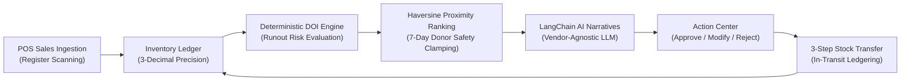
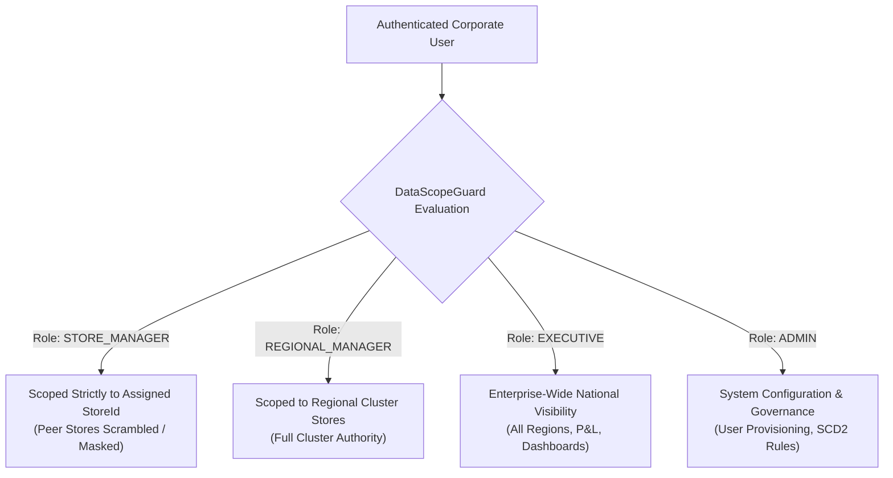
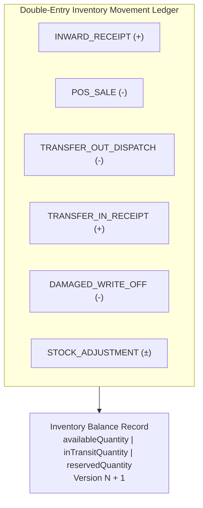
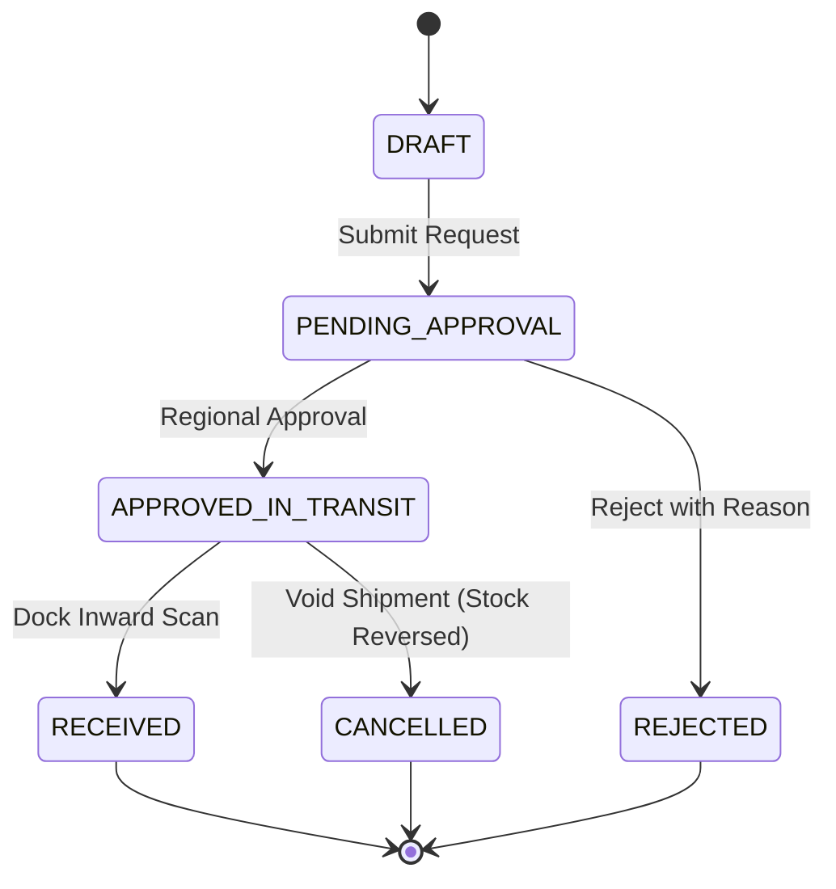
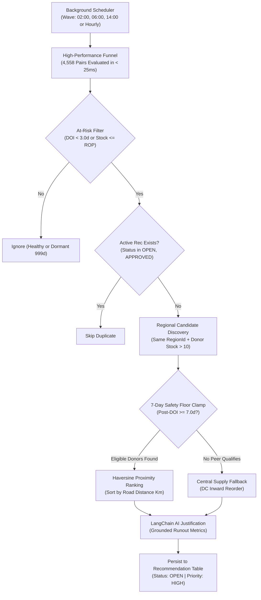
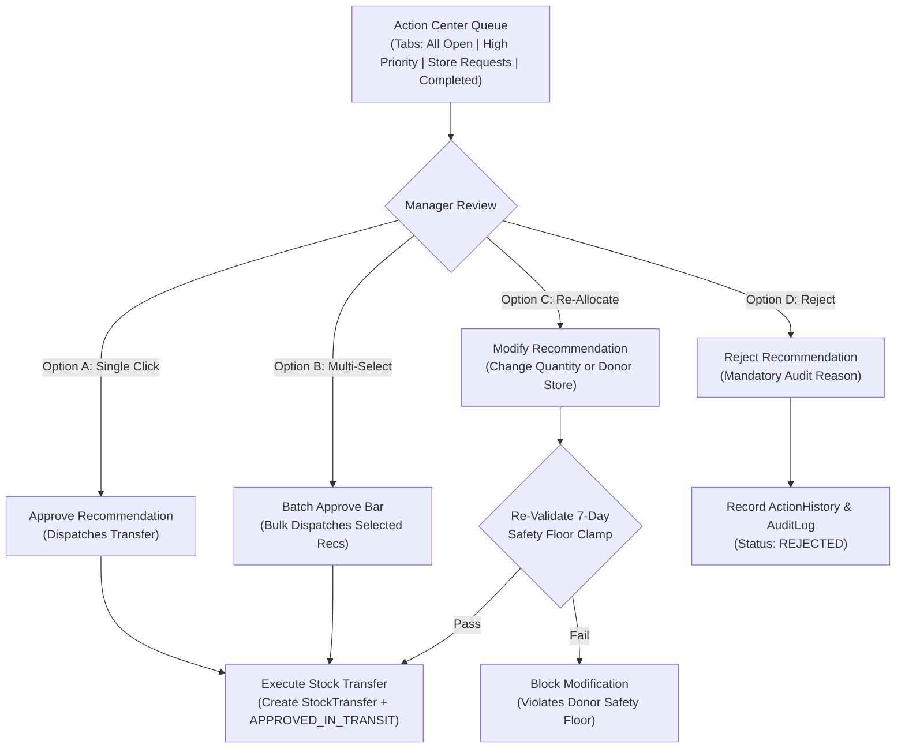

# RETAILHUB ENTERPRISE OPERATIONS PLATFORM
## Comprehensive Client Demonstration & Architectural Reference Guide
**Confidential & Proprietary — For Client Enterprise Demonstration & Operational Evaluation**

---

  <h3>RETAILHUB ENTERPRISE FOUNDATION</h3>
  
<b>High-Velocity Multi-Echelon Retail Inventory Rebalancing, POS Ingestion & Autonomous Logistics Platform</b>

  
<i>Modeled after High-Velocity Value Retail Networks (D-Mart / JioMart Model)</i>

---

## TABLE OF CONTENTS
- [PAGE 1: Executive Overview, Architecture & Value Proposition](#page-1-executive-overview-architecture--value-proposition)
- [PAGE 2: Enterprise Roles, Responsibilities & Authority Matrix](#page-2-enterprise-roles-responsibilities--authority-matrix)
- [PAGE 3: Core Operations Modules & Inventory Health Engine](#page-3-core-operations-modules--inventory-health-engine)
- [PAGE 4: Intelligence Engine & Recommendation Generation (Autonomous vs. Manual)](#page-4-intelligence-engine--recommendation-generation-autonomous-vs-manual)
- [PAGE 5: Action Center Workflows, Human-in-the-Loop & Transfer Execution](#page-5-action-center-workflows-human-in-the-loop--transfer-execution)
- [PAGE 6: Analytics, 6 Enterprise Reports, Audit Trail & 15-Minute Client Demo Script](#page-6-analytics-6-enterprise-reports-audit-trail--15-minute-client-demo-script)

---

<!-- PAGE BREAK -->

# PAGE 1: Executive Overview, Architecture & Value Proposition

### 1.1 Executive Overview
**RetailHub Enterprise** is an operational platform engineered specifically for discount and hypermarket retail networks managing tens of thousands of SKUs across high-density regional store clusters. In modern retail, inventory misallocation is catastrophic: **Store A suffers stockouts of high-velocity essentials, losing immediate revenue and foot traffic, while Store B (just 25 km away in the same city or cluster) holds excess dormant inventory tying up precious working capital.**

RetailHub solves this structural inefficiency through an automated, real-time closed loop:
1. **Continuous POS Sales Tracking**: Captures register transactions to establish real rolling Average Daily Sales (ADS).
2. **Deterministic Runout Mathematics**: Calculates accurate Days of Inventory (DOI) for every SKU in every store.
3. **Proximity-Aware Regional Rebalancing**: Identifies surplus donor stores within the same cluster using Haversine road-distance formulas while enforcing a strict **7-Day Donor Safety Floor**.
4. **Human-in-the-Loop Generative AI**: Generates grounded, multi-lingual executive narratives justifying every transfer proposal, enabling store and regional managers to approve, modify, or reject actions in seconds.

---

### 1.2 Enterprise Technical Architecture

RetailHub is designed with a **Modular Monolith** pattern that delivers enterprise-grade isolation, sub-20ms dashboard performance, and audit compliance:

* **Presentation Layer**: Built on **React 19**, **Vite**, **TanStack React Query v5**, and **Tailwind CSS**. It incorporates a strict design system with Radix UI accessibility primitives, responsive mobile drawer views for store floor associates, and real-time Socket.io notifications.
* **Core Application API**: Enterprise **NestJS 10** architecture alongside an agile **Express 4 companion runtime**, fully written in strict TypeScript. Features global exception translation filters, transform response envelopes, and execution interceptors.
* **Database & Persistence**: Powered by **Microsoft SQL Server** via **Prisma ORM (v5)**, structured across **21 fully normalized relational entities** with table-level filtered indexes, cascade controls, and double-entry movement ledgering.
* **Artificial Intelligence & LLM Service**: Vendor-agnostic **LangChain** engine supporting **Google Gemini 2.5 Flash**, **Gemini 3.5 Flash**, **Gemini 3.1 Pro Preview**, and an air-gapped **Deterministic Rule Engine** that guarantees zero-latency offline execution.
* **Caching & Real-Time Events**: In-memory caching engine (`@nestjs/cache-manager`) providing sub-20ms executive dashboard delivery, coupled with a WebSocket Gateway (`EventsGateway`) broadcasting inventory movements and recommendation states to scoped store rooms.

---

### 1.3 Key Operational Benchmarks & System Metrics

| Operational Metric | RetailHub Performance Specification | Industry Benchmark Comparison |
| :--- | :--- | :--- |
| **Catalog Scan Throughput** | **4,558 Store-SKU Pairs evaluated in < 1,600 ms** | 15–45 minutes in legacy batch ERPs |
| **Stock Ledger Precision** | **3-Decimal Precision (`Decimal(10, 3)`)** | Standard integer or 2-decimal truncations |
| **Concurrency Safeguard** | **Optimistic Locking (`INV_CONCURRENCY_CONFLICT`)** | Silent overwrite / phantom inventory |
| **Donor Protection** | **Hard 7-Day Safety Floor Clamp** | Unconstrained transfers causing secondary stockouts |
| **Dashboard API Response** | **< 20 ms via Global In-Memory Cache** | 3.5 – 8.0 seconds in legacy reporting cubes |
| **Audit Compliance** | **100% Immutable JSON Delta Logs with Sensitive Stripping** | Unstructured text logs / missing diffs |

---

<!-- PAGE BREAK -->

# PAGE 2: Enterprise Roles, Responsibilities & Authority Matrix

RetailHub enforces **Strict Server-Side Data Scoping** via the [`DataScopeGuard`](file:///d:/retailhub-enterprise-foundation/apps/api/src/core/security/data-scope.guard.ts). A user's token is digitally signed with their corporate role, assigned store IDs, and regional cluster IDs. Unauthorized access to peer stores or financial metrics is intercepted at the database query level.

---

### 2.1 Detailed Role Profiles & Responsibilities

#### 1. Store Manager (`STORE_MANAGER`)
* **Role Summary**: In charge of daily floor operations, local receiving dock, cycle counts, register operations, and local inventory health at an assigned retail store.
* **Responsibilities**:
  * Execute daily dock receiving of incoming stock transfers with barcode shortfall verification.
  * Adjust physical stock upon cycle count variances with mandatory reason codes.
  * Request urgent store-level stock replenishment from regional peers or Central Supply.
  * Review local stockout callouts and act on store-level transfer recommendations.
* **Data Boundary**: **Strictly quarantined to their assigned store**. Cannot see financial valuation, cost margins, or inventory balances of other stores. Peer stores in the network directory are visible solely as operational contact entries (manager phone, store code, address).

#### 2. Regional Manager (`REGIONAL_MANAGER`)
* **Role Summary**: Operational leader overseeing an entire geographical cluster of 8 to 25 stores (e.g., Western Maharashtra, Central MP, Gujarat).
* **Responsibilities**:
  * Authorize, modify, or reject inter-store transfer recommendations proposed by the AI engine.
  * Execute batch approvals for morning replenishment dispatch waves across the region.
  * Monitor cluster-wide Days of Inventory (DOI), bottleneck stores, and transit logistics.
  * Resolve donor store disputes and enforce the 7-day donor safety floor.
* **Data Boundary**: Fully scoped to all stores belonging to their assigned **Region ID**. Cannot access operational data or reports of other geographical regions.

#### 3. Executive (`EXECUTIVE`)
* **Role Summary**: Vice President of Retail Operations, Chief Supply Chain Officer, and Merchandising Directors.
* **Responsibilities**:
  * Review top-line national network health (National Active DOI, Stockout Risk Valuation, Capital Tied in Excess Stock).
  * Analyze cross-regional supply chain trends, velocity category heatmaps, and regional performance.
  * Override system-wide rebalance rules, approve extraordinary supply allocations, and monitor P&L margins.
* **Data Boundary**: **Enterprise-wide access**. Full visibility across all regions, stores, categories, and audit logs.

#### 4. Platform Administrator (`ADMIN`)
* **Role Summary**: IT Systems Administrator, Security Lead, and Operational Governance Manager.
* **Responsibilities**:
  * Provision corporate user accounts, manage Argon2 credential resets, and bind store/region assignments.
  * Configure Background Engine wave hours (02:00, 06:00, 14:00) and periodic sweep intervals.
  * Maintain Slowly Changing Dimensions (SCD Type 2) store inventory rule policies.
  * Inspect the enterprise audit trail with field-level JSON diffs.
* **Data Boundary**: Enterprise-wide configuration and governance access.

---

### 2.2 Enterprise Role Authority Matrix (Who Can & Cannot Do What)

| Feature / Operation | Store Manager | Regional Manager | Executive | Platform Admin |
| :--- | :---: | :---: | :---: | :---: |
| **Executive Dashboard & Enterprise KPIs** | ❌ Blocked | ❌ Blocked | ✅ Full Access | ✅ Full Access |
| **Scoped Store Manager Dashboard** | ✅ Own Store Only | ✅ Scoped Cluster | ✅ Any Store | ✅ Any Store |
| **Catalog & Product Master View** | ✅ Read-Only | ✅ Full Catalog | ✅ Full Catalog | ✅ Full Catalog |
| **Create Product & CSV Bulk Onboarding** | ❌ Blocked | ❌ Blocked | ❌ Blocked | ✅ Full Access |
| **Stock Adjustments & Cycle Counts** | ✅ Own Store Only | ✅ Scoped Cluster | ❌ Blocked | ✅ Override Allowed |
| **Stock Transfer Inward Receiving** | ✅ Own Store Dock | ❌ Read-Only | ❌ Read-Only | ✅ Override Allowed |
| **Initiate Store Request (Manual Rec)** | ✅ Own Store Only | ✅ Scoped Cluster | ❌ Blocked | ✅ Full Access |
| **Approve / Batch Approve Recs** | ❌ Blocked | ✅ Scoped Cluster | ✅ Enterprise-Wide | ✅ Full Access |
| **Modify Recommendation Qty / Donor** | ❌ Blocked | ✅ Scoped Cluster | ✅ Enterprise-Wide | ✅ Full Access |
| **Reject Recommendation (With Reason)** | ❌ Blocked | ✅ Scoped Cluster | ✅ Enterprise-Wide | ✅ Full Access |
| **Configure Background Engine Waves** | ❌ Blocked | ❌ Blocked | ❌ Blocked | ✅ Full Access |
| **Manage SCD Type 2 Inventory Rules** | ❌ Blocked | ❌ Blocked | ❌ Read-Only | ✅ Full Access |
| **User Management & Role Binding** | ❌ Blocked | ❌ Blocked | ❌ Blocked | ✅ Full Access |
| **Enterprise Audit Log Inspection** | ❌ Blocked | ❌ Blocked | ✅ Read-Only | ✅ Full Inspection |

---

<!-- PAGE BREAK -->

# PAGE 3: Core Operations Modules & Inventory Health Engine

### 3.1 Master Catalog & Barcode-First Ingestion
Retail operations demand split-second register lookups and bulk product onboarding:
* **Barcode-First Search Engine**: Supports instant exact-match lookups on standard **13-digit EAN/UPC barcodes** (`productCode`). If no barcode matches, the engine seamlessly falls back to tri-gram partial text matching across product names and SKUs in under 12 ms.
* **Recursive Category Hierarchy**: High-velocity hierarchy structured using self-referencing nodes (`parentCategoryId`). The UI combobox provides a multi-level drill-down (Department $\rightarrow$ Aisle $\rightarrow$ Shelf Category) with flat lookup caching.
* **D-Mart Value-Pricing Policy Enforcement**: Every catalog item strictly validates the retail margin constraint:
  $$\text{MRP} \ge \text{Selling Price} \ge \text{Cost Price}$$
  System prevents onboarding any product where Selling Price drops below Cost Price (loss mitigation) or exceeds Government MRP (compliance).
* **Chunked CSV Batch Onboarding**: Upload up to 1,000 product rows in a single batch, parsed and committed in resilient 100-item database chunks with validation error reporting per row.

---

### 3.2 Inventory Balances & High-Precision Ledgering
RetailHub avoids the pitfalls of integer truncation by maintaining all physical quantities as `Decimal(10, 3)` (supporting loose bulk grains, produce, and packaged units down to 0.001 kg).

* **Optimistic Concurrency Protection**: Every inventory balance record carries an integer `version` field. When a POS checkout or stock adjustment commits, the update verifies `WHERE version = expectedVersion`. If another checkout modified the balance concurrently, the transaction rolls back cleanly with code `INV_CONCURRENCY_CONFLICT`, preventing phantom stock.
* **Immutability of Movements**: Physical stock is never altered without an accompanying `InventoryMovement` row capturing movement type, quantity, reference transaction, operator ID, and timestamp.

---

### 3.3 The 3-Step Stock Transfer State Machine
Inter-store movements follow an audited, closed-loop state machine that prevents stock loss during road transit:

1. **Step 1: Initiation (`PENDING_APPROVAL`)**: Triggered either autonomously by the AI Rebalance Engine or manually by a Store Manager. Donor and recipient stores are designated with requested quantities.
2. **Step 2: Dispatch (`APPROVED_IN_TRANSIT`)**: Regional Manager approves the transfer. The donor store's `availableQuantity` decrements immediately, and `inTransitQuantity` increments. The physical goods are loaded onto a logistics carrier with generated Dispatch Note Numbers and vehicle tracking.
3. **Step 3: Inward Receipt & Short-Shipment Settlement (`RECEIVED`)**: The receiving store dock scans the physical shipment.
   * If received quantity matches dispatched quantity ($Q_{\text{recv}} = Q_{\text{disp}}$), `inTransitQuantity` clears and destination `availableQuantity` increments.
   * **Automated Damaged / Shortage Write-Off**: If a shortfall occurs (e.g., 20 dispatched, but only 18 received due to transit breakage), the system accepts the 18 units into available stock and **automatically creates an audited `DAMAGED_WRITE_OFF` movement for the remaining 2 units**, balancing the ledger.

---

### 3.4 POS Sales Ingestion & Real-Time ADS Velocity
* Registers stream transaction receipts directly via `POST /api/v1/sales/transactions`.
* Point-of-sale checkouts snapshot point-in-time prices and immediately deduct shelf stock.
* **Rolling 30-Day Average Daily Sales (ADS)**:
  $$\text{ADS} = \frac{\sum_{t=1}^{30} \text{Quantity Sold}_t}{30.0}$$
  * Zero-sales products safely yield $\text{ADS} = 0.000$, resulting in a dormant $\text{DOI} = 999.0\text{ days}$ (zero false rebalance alarms).

---

<!-- PAGE BREAK -->

# PAGE 4: Intelligence Engine & Recommendation Generation (Autonomous vs. Manual)

### 4.1 Days of Inventory (DOI) & Stock Health Tiers
At the core of RetailHub is the deterministic runout formula:
$$\text{DOI} = \begin{cases} 
0.0 & \text{if } \text{Available Stock} \le 0 \\
999.0 & \text{if } \text{ADS} \le 0 \text{ and } \text{Available Stock} > 0 \\
\dfrac{\text{Available Stock}}{\text{Rolling ADS}} & \text{otherwise}
\end{cases}$$

Every SKU in every store is categorized into four operational health zones:
* CRITICAL ($\text{DOI} < 3.0\text{ days}$ or Stock $\le$ ROP): Immediate stockout risk; revenue bleed occurring; top priority rebalance trigger.
* LOW ($3.0 \le \text{DOI} < 7.0\text{ days}$): Nearing replenishment threshold; proactive rebalance candidate.
* HEALTHY ($7.0 \le \text{DOI} \le 30.0\text{ days}$): Ideal operational equilibrium; optimal working capital utilization.
* EXCESS ($\text{DOI} > 30.0\text{ days}$): Surplus stock tying up floor space and capital; primary candidate donor.

---

### 4.2 Autonomous Generation: The Background Engine

The Autonomous Engine scans the entire enterprise network without requiring manual intervention.

#### Key Autonomous Safeguards:
1. **The 7-Day Donor Safety Floor**: A donor store is prohibited from transferring stock if the transfer would push its own projected runout below 7 days:
   $$\text{Post-Transfer DOI}_{\text{donor}} = \frac{\text{Current Stock}_{\text{donor}} - \text{Transfer Qty}}{\text{ADS}_{\text{donor}}} \ge 7.0\text{ days}$$
   This guarantees that solving a stockout at Store A **never causes a secondary stockout at Store B**.
2. **Haversine Road Proximity Ranking**: Ties between multiple surplus stores are broken by physical distance:
   $$d = 2R \cdot \arcsin\left(\sqrt{\sin^2\left(\frac{\Delta \text{lat}}{2}\right) + \cos(\text{lat}_1)\cos(\text{lat}_2)\sin^2\left(\frac{\Delta \text{lon}}{2}\right)}\right) \quad (R = 6371\text{ km})$$
3. **Self-Healing Auto-Expiration**: If an unapproved recommendation is pending and a physical delivery or cycle adjustment raises the destination stock above the reorder point, the background engine automatically transitions the recommendation to `AUTO_EXPIRED`, preventing redundant deliveries.

---

### 4.3 Manual Generation: Store Manager Stock Requests

Store Managers can raise manual requests directly from the floor:
* Accessible via the **Action Center $\rightarrow$ "New Store Request"** modal.
* **Workflow**: The manager selects an SKU, enters the required quantity, chooses an urgency level (`HIGH`, `MEDIUM`, `LOW`), and provides an operational reason (e.g., *"Anticipated weekend festive demand spike"*).
* The system flags the record as `isManualRequest = true` and attaches the user's ID (`requestedByUserId`).
* The recommendation appears instantly in the Regional Manager's Action Center queue with a visual **"STORE REQUEST"** badge.

---

### 4.4 Vendor-Agnostic LangChain Engine & Model Switcher

Every recommendation is accompanied by an authoritative, 2-sentence executive justification citing runout days and safety buffers. The system supports live model switching via [`ConfigurationsPage.tsx`](file:///d:/retailhub-enterprise-foundation/src/pages/ConfigurationsPage.tsx):
* **Gemini 2.5 Flash**: Default production model; balanced reasoning speed (< 600 ms).
* **Gemini 3.5 Flash**: High-capacity architecture for massive multi-category network scans.
* **Gemini 3.1 Pro Preview**: Deep multi-echelon reasoning for complex multi-regional logistics constraints.
* **Deterministic Rule Engine**: Zero-latency offline engine running entirely without internet or external API dependencies (essential for air-gapped retail servers or quota limits).

---

<!-- PAGE BREAK -->

# PAGE 5: Action Center Workflows, Human-in-the-Loop & Transfer Execution

The **Action Center** is RetailHub's primary decision cockpit. It converts mathematical alerts into actionable operational transfers.

---

### 5.1 Action Center User Interface Anatomy

The interface is built to provide total contextual clarity before committing stock:
1. **Side-by-Side Store Comparison Cards**: Displays destination store vs. donor store metrics side-by-side:
   * Current Available Stock vs. Post-Transfer Stock.
   * Current DOI vs. Projected Post-Transfer DOI.
   * Visual 4-Zone Color Gauges displaying runout zones.
2. **AI Executive Narrative Card**: Cites exact metrics and transit hours.
3. **Candidate Store Selector Dropdown**: Allows the manager to override the AI's donor choice, ranking all alternative stores in the cluster by distance while showing their safety status.

---

### 5.2 The 4 Operational Actions

#### 1. Single Approval (`APPROVE`)
* **Trigger**: Manager clicks **"Approve Transfer"** on a recommendation card or drawer.
* **Database Execution**:
  * If Peer-to-Peer: Creates `StockTransfer` with status `APPROVED_IN_TRANSIT`, generates vehicle tracking, decrements donor `availableQuantity`, increments donor `inTransitQuantity`, and logs `TRANSFER_OUT_DISPATCH`.
  * If Central Supply: Increments destination available stock and logs `INWARD_RECEIPT`.
  * Updates `Recommendation` status to `APPROVED` and commits an `ActionHistory` record.

#### 2. Batch Approval (`BATCH_APPROVE`)
* **Trigger**: Manager selects 5 to 50 recommendations using table checkboxes and clicks **"Approve Selected (N)"** on the floating `BatchApproveBar`.
* **Execution**: Processes all selected recommendations in a single atomic transaction. Aggregates total units and total retail inventory valuation approved, issuing bulk logistics transfer manifests.

#### 3. Modification with Safety Clamp (`MODIFY`)
* **Trigger**: Manager clicks **"Modify"** to adjust the recommended quantity or select a different donor store.
* **Safety Verification**: The backend dynamically re-evaluates the donor safety formula. If a manager attempts to transfer 40 units from a store that only has 30 units of surplus, the system rejects the modification with `INVALID_MODIFICATION_QUANTITY: Breaches 7-day donor safety floor`.
* Requires mandatory operational comments explaining the override.

#### 4. Rejection (`REJECT`)
* **Trigger**: Manager clicks **"Reject"**.
* **Governance**: The system blocks rejection unless a valid business reason is provided (e.g., *"Local promotion planned at donor store"*, *"Road transit blocked due to regional maintenance"*).
* The status transitions to `REJECTED`, and the audit log records the decision.

---

<!-- PAGE BREAK -->

# PAGE 6: Analytics, 6 Enterprise Reports, Audit Trail & 15-Minute Client Demo Script

### 6.1 Dashboards & Reporting Suite

#### Executive Dashboard (`/dashboard/executive`)
* **6 Strategic KPIs**: Active Network DOI, Stockout Risk Valuation (INR), Capital in Excess Stock (INR), Active Stock Transfers, System Health Score (%), and Total Store Count.
* **5 Interactive Recharts Visualizations**: 7-Day Net Sales Velocity Trends, Regional Stock Health Distribution, DOI Category Gauges, In-Transit Transfer Map, and Store Cluster Rankings.

#### Store Manager Dashboard (`/dashboard/store`)
* Store-scoped view displaying local shelf stock, incoming transfer ETA countdowns, high-priority stockout warnings, and top 5 velocity movers.

#### The 6 Role-Scoped Exportable Reports (`/reports`)
All reports feature date filtering, store/category search, and **1-click Export to Excel (.xlsx) or Print-Ready PDF**:
1. **Sales & Margin Contribution Report**: Line-item transaction analysis including invoice numbers, SKU, units sold, unit selling price, net revenue, and gross profit margin.
2. **Inventory Health & Valuation Report**: Current balances, in-transit units, rolling ADS, active DOI, min/max limits, unit cost, and stock health tier classification.
3. **Store Performance Matrix Report**: Aggregated comparative analysis of all 50 stores across revenue, units sold, gross margin %, inventory valuation, and health score.
4. **Recommendation & Rebalancing Audit Report**: Historical archive of every proposal generated, comparing before vs. after DOI, donor store, road distance, and approving manager.
5. **16-Column Master SKU Performance Report**: Granular product performance encompassing barcode, category, brand, UOM, Cost/MRP/Selling Price, margin %, valuation, units sold, ADS, and velocity tier (`FAST_MOVING`, `MODERATE`, `SLOW_MOVING`, `DEAD_STOCK`).
6. **Scoped Audit Trail Report**: Immutable compliance audit trail tracking user IDs, actions (`APPROVE`, `MODIFY`, `REJECT`, `CYCLE_ADJUST`), affected entities, and JSON field deltas.

---

### 6.2 Step-by-Step 15-Minute Client Demonstration Script (Zero-Dependency Demo Mode)

Follow this structured demonstration script during your client walkthrough:

#### Minute 00 – 02: 1-Click Persona Login & Zero-Backend Architecture
1. Launch the application in the browser (`npm run dev` or `npm run preview` — no local SQL Server installation required).
2. Point out the **Interactive Demo Mode** banner on the login screen.
3. Demonstrate the **1-Click Demo Login Personas**:
   * Click **Vikram Aditya (VP Retail Operations)** card to sign in with 1 click without typing credentials.
   * Highlight automatic role-based landing on the **Executive Dashboard**.

#### Minute 02 – 05: Executive Dashboard & Enterprise Problem Framing
1. Highlight the **Top KPI Metrics**:
   * Point out *Active Network DOI* and explain the retail ideal buffer (7–30 days).
   * Show *30d Net Revenue* (`₹14.86 Cr+`), *Stock Valuation*, and *Enterprise Health Score*.
   * Explain: *"RetailHub continuously moves trapped capital from surplus donor stores to stockout-threatened stores without purchasing new inventory from suppliers."*
2. Showcase the **5 Interactive Visualizations**:
   * *Sales Velocity Trends*, *Health Distribution Donut*, *Top 5 At-Risk Stores*, and *Category Revenue vs Stock Value*.

#### Minute 05 – 08: Real-Time POS Register Simulation & Autonomous Trigger
1. Navigate to **Operations → Sales**.
2. Point out the real-time POS transaction log sorted strictly **newest-first** with invoice numbers, store locations, and gross margins.
3. Click **"Simulate POS Sale"** to open the register checkout modal:
   * Select a store (e.g., `BLR-024 — Bengaluru Sector-10 Hypermarket`) and SKU (`SKU-1298` or `SKU-1316`).
   * Show live available shelf stock validation (`55.000 PACK`).
   * Enter quantity to sell (e.g., `55.000` units sold out).
   * Click **"Post POS Sale"**.
4. Point out the success toast and show that:
   * The new invoice appears immediately at the top of the sales audit log.
   * The store shelf stock drops to `0.000 units`.
   * **The Rebalance Intelligence Engine autonomously detects the critical stockout (< 7.0d DOI) and generates a new HIGH Priority Recommendation in the Action Center!**

#### Minute 08 – 12: The Action Center & Autonomous Intelligence in Action
1. Navigate to **Intelligence → Action Center**.
2. Show the newly generated **HIGH Priority** recommendation at the top of the table.
3. Click **"Review"** to inspect the **Interactive Rebalance Modal**:
   * **Full-Width AI Executive Briefing**: Powered by Gemini 2.5 Flash, explaining the demand velocity, transit time, and why regional replenishment is required.
   * **Store Stock & DOI Balance Simulation**: Shows live destination shelf stock before (`0.000u`, `0.0d DOI`) and projected after (`55.000u`, `14.1d DOI`).
   * **Ranked Candidate Selection**: Show that Central Supply is ranked **Rank 1 (Recommended)**, while sister peer stores display distance, transit time, and explicit **⚠️ DOI Floor Risk warnings** if a transfer would violate their 7.0-day safety buffer.
4. Demonstrate **Human-in-the-Loop Actions**:
   * Adjust the transfer quantity or select a candidate donor store.
   * Click **"Approve Transfer"** → Show instant state transition to `APPROVED` and automated creation of a formal `StockTransfer` order.

#### Minute 12 – 14: Stock Transfers & Inward Receiving Dock
1. Navigate to **Operations → Stock Transfers**.
2. Show the newly created transfer in `IN_TRANSIT` state.
3. Filter by shipment type (`ALL`, `INCOMING`, `OUTGOING`).
4. Click **"Receive Transfer"** on the shipment:
   * Demonstrate receiving the dispatched quantity.
   * Show that the units move automatically from *In-Transit* to *Available Shelf Stock* at the destination store!

#### Minute 14 – 15: Fast Reset Utility & C-Suite Summary
1. Point out the **"Reset Demo Data"** button in the top navigation header and user profile menu.
2. Click **"Reset Demo Data"** to demonstrate how the entire browser database restores instantly to clean enterprise baseline between presentations.
3. Conclude with the business ROI summary:
   * **Zero capital expenditure** (cross-leveling existing sister store inventory).
   * **+15–20% Working Capital Turn Acceleration** (compressing Cash Conversion Cycle).
   * **Zero preventable out-of-stocks** on high-velocity revenue-driving essentials.

---

### 6.3 Standard Demo User Credentials & 1-Click Personas

| Persona Name | Corporate Role | Email Login | Password | Assigned Operational Scope | 1-Click Login |
| :--- | :--- | :--- | :--- | :--- | :---: |
| **Ananya Deshmukh** | Platform Administrator | `admin@retailhub.com` | `RetailHub@2026` | Enterprise-wide full governance | Yes |
| **Vikram Aditya** | Executive (VP Operations) | `executive@retailhub.com` | `RetailHub@2026` | Enterprise analytics & C-suite KPIs | Yes |
| **Priya Nair** | Regional Manager | `regional.central@retailhub.com` | `RetailHub@2026` | Central MP corridor (Action Center) | Yes |
| **Rajesh Sharma** | Store Manager | `store.bhopal@retailhub.com` | `RetailHub@2026` | Bhopal Hypermarket (BPL-001) | Yes |

---
*End of RetailHub Enterprise Client Demonstration Document*
